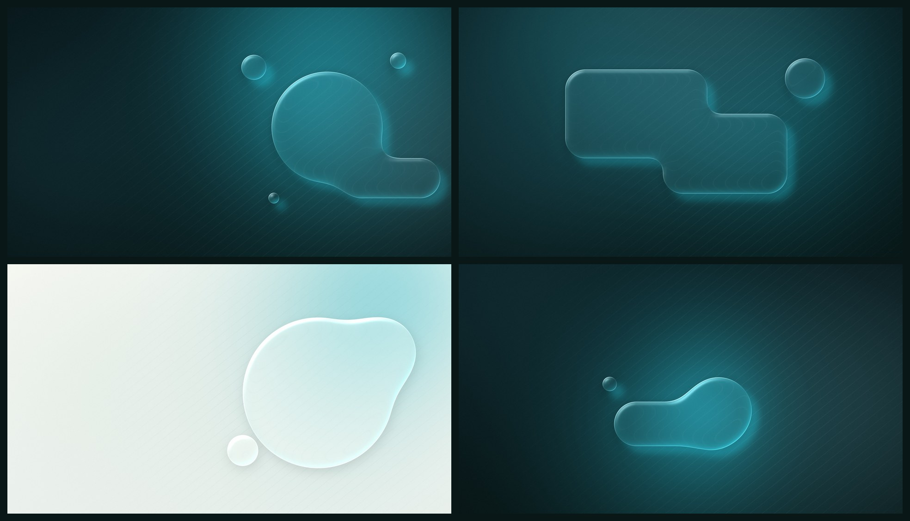

# Liquid Glass for Windows

A desktop theme for Windows 11 (most of it also works on Windows 10) with a
liquid-glass look inspired by Perplexity's visual style: deep off-black and
turquoise colors, refractive glass shapes, soft glows and a fine film grain.



## What's in here

| File | What it is |
| --- | --- |
| `wallpapers/*.jpg` | Four 4K (3840x2160) wallpapers: `depth` (main), `panels`, `paper` (light) and `lockscreen` |
| `Apply-LiquidGlass.ps1` | One-shot script: dark mode, transparency, turquoise accent, wallpaper and lock screen |
| `Restore-Windows.ps1` | Puts your previous settings back (uses the backup the apply script saves) |
| `extras/windows-terminal-liquid-glass.json` | Matching acrylic color scheme for Windows Terminal |
| `wallpapers/generate.py` | The generator that rendered the wallpapers, in case you want other sizes or shapes |

## 1. Apply the theme (2 minutes)

1. Download this repo to your PC (**Code > Download ZIP**, then unzip it).
2. Open the unzipped folder, click the address bar, type `powershell` and press Enter.
3. Run:

```powershell
powershell -ExecutionPolicy Bypass -File .\Apply-LiquidGlass.ps1
```

The screen flickers once while Explorer restarts. That's normal.

To set the **lock screen** too, run the same command from PowerShell opened with
**Run as administrator**. Without admin rights the script tells you where to set it
by hand.

Options:

```powershell
.\Apply-LiquidGlass.ps1 -Wallpaper panels       # floating glass cards instead of the liquid drop
.\Apply-LiquidGlass.ps1 -Theme Light            # light "Paper" version
.\Apply-LiquidGlass.ps1 -InstallGlassApps       # also installs the apps in step 2 via winget
```

What it changes: apps in dark mode, Start menu and taskbar dark, transparency on, a
turquoise accent palette (`#20808D` with lighter and darker shades), translucent title
bars (no solid accent color), and wallpaper set to Fill. Every value it changes is backed
up to `%LOCALAPPDATA%\LiquidGlass\backup.xml` first.

## 2. Make the glass stronger (optional apps)

Windows on its own only gives you subtle Mica and acrylic effects. These free apps push
it closer to real liquid glass. `-InstallGlassApps` installs the first three for you.

- **TranslucentTB** makes the taskbar see-through. In its tray menu, set
  *Desktop* to **Clear** and *Visible window* to **Acrylic**.
- **Windhawk** is a mod manager. Inside it, install:
  - **Windows 11 Taskbar Styler**: pick a translucent theme in its settings for floating, glassy taskbar buttons.
  - **Windows 11 Start Menu Styler**: pick a translucent theme for a see-through Start menu.
- **Mica For Everyone** adds Mica or acrylic blur to apps that don't have it. Set the
  global rule's backdrop to **Acrylic** and title bar color to **Dark**.
- **ExplorerBlurMica** ([github.com/Maplespe/ExplorerBlurMica](https://github.com/Maplespe/ExplorerBlurMica))
  makes File Explorer windows blurred glass. You install it by hand from its releases page.

## 3. Windows Terminal (optional)

Open Windows Terminal, press `Ctrl+Shift+,` to open `settings.json`, then:

- paste the `scheme` object from `extras/windows-terminal-liquid-glass.json` into the `"schemes": [ ... ]` list
- copy the keys under `profileDefaults` into `"profiles": { "defaults": { ... } }`

If the background image doesn't show, replace `%USERPROFILE%` in that path with your
full user folder, for example `C:\\Users\\you`.

## Undo everything

```powershell
powershell -ExecutionPolicy Bypass -File .\Restore-Windows.ps1
```

Run it as administrator if you also set the lock screen. To remove the apps from step 2,
use **Settings > Apps > Installed apps**.

## Palette

| Name | Hex | Role |
| --- | --- | --- |
| Offblack | `#091717` | Background |
| Inky Blue | `#13343B` | Deep shadow |
| Peacock | `#2E565E` | Glass tint |
| True Turquoise | `#20808D` | Accent |
| Plex Blue | `#1FB8CD` | Glow and highlight |
| Sky | `#BADEDD` | Light lines |
| Paper White | `#FBFAF4` | Light mode |

## Regenerate the wallpapers

```bash
pip install numpy pillow
python wallpapers/generate.py --w 2560 --h 1440       # any resolution, e.g. ultrawide 3440x1440
```
