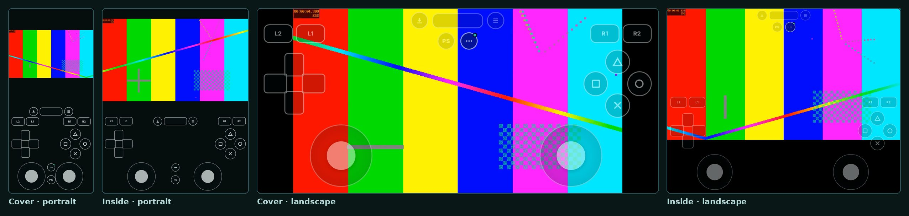

# DuoPlay

PS5 Remote Play for **iPhone Duo**, in Safari, built around the Duo's two screens and
tuned for Wi-Fi.



## Why there is a bridge

A web page in Safari can't connect to a PS5 on its own:
- Remote Play runs over raw UDP and TCP with Sony's own encryption.
- Safari only gives pages HTTP, WebSocket and WebRTC.
- The PS5 speaks none of those.
- The one browser API for raw sockets (Direct Sockets) is Chrome-only, and only for installed "isolated" apps.

That's why every PS5 Remote Play app on the Duo is a native App Store app (Sony's
**PS Remote Play**, **Asobi**, which added Duo support, and others).

So DuoPlay has two parts:

```
PS5 ──(Remote Play, wired)──► DuoPlay bridge ──(Wi-Fi, WebRTC)──► iPhone Duo (Safari, Home Screen app)
                              any always-on device
```

- **The bridge** is a small program on any always-on device at home: a Raspberry Pi, an
  old laptop, a Mac mini or a NAS. It talks to the console with
  [chiaki-ng](https://github.com/streetpea/chiaki-ng)'s open-source Remote Play library. It
  forwards the console's own video and audio **without re-encoding** and serves the app.
- **The app** is a Safari web app built for the Duo. You add it to the Home Screen from the
  bridge's address, and from then on it launches like any other app.

A **Raspberry Pi Zero W** is enough, and it can be set up from the iPhone alone (see
[Raspberry Pi Zero W](#raspberry-pi-zero-w-set-up-from-the-iphone)). A preview of the DuoPlay
app, with a demo game in place of the console, runs without a bridge. It lets you try the
screens, controls and HDR check on the phone itself.

## Built for iPhone Duo

**Knows which screen it's on.**
- Both screens are the same shape (about 1.43:1), so DuoPlay tells them apart by size. The
  cover screen is 466 × 678 pt and the inside screen 669 × 951 pt.
- It recognises Split View, and the half-folded posture when Safari reports it.
- A small chip on the home screen shows what it detected.

**A layout for every way you hold it.**

| | |
| --- | --- |
| Cover, portrait | Picture on top, full controller below. Nothing covers the game. |
| Cover, landscape | Picture across the top, controls at the sides, sticks in the band below. |
| Inside, portrait | **Handheld mode**: the game sits on the top half and the whole controller on the bottom half, with nothing on the fold. Half-fold the phone like a laptop and it's a pocket console. |
| Inside, landscape | Picture across the top, controls in the corners. The small centre buttons step to either side of the fold. |
| Split View | A compact version of the cover layout, for playing next to a guide. |
| Half-folded (laptop) | Uses the exact fold position from Safari 27.1's Device Posture and Viewport Segments APIs. These are behind Settings → Apps → Safari → Advanced → Feature Flags; without them, handheld mode is used. |

**Seamless folding.**
- Fold, unfold or rotate mid-game and the new arrangement is in place in the first frame
  drawn on the new screen. Nothing reloads and the connection isn't touched: the test
  switches screens six times mid-stream with zero reconnects.
- Buttons held during a fold are released at once, so nothing gets stuck.
- Controls keep the same physical size on both screens, because your thumbs don't grow when
  the phone opens.
- Control size and opacity are saved separately per screen.
- Safe areas are re-read on every change, since the Dynamic Island runs down the side.

**Feels like an app.**
- **Launch.** Launch images match both screens and both orientations. They hand over to an
  unfolding-panel launch animation and then to the app, with no white flash.
- **Look.** Liquid Glass materials throughout. On the inside screen the home screen becomes
  two pages with the gap on the fold, and Settings opens on the right-hand page while the
  game stays visible on the left.
- **Haptics.** A Taptic tick on every button press, using iOS's switch-control haptic.
- **Screen.** The screen stays awake while you play.
- **Controllers.** DualSense, DualShock 4, Xbox and MFi controllers work through Safari's
  Gamepad API. Touch controls fade out while you use one. Safari on iPhone has no controller
  rumble API, so console rumble can't be passed on.

## HDR

The PS5 streams HDR as 10-bit HEVC with HDR10 (PQ) colour. Safari can't be relied on for
HEVC over WebRTC, so HDR uses Safari's own media player instead. That player renders HDR10
natively on the Duo's 1600-nit panels.
- The bridge asks the console for its HDR stream.
- It wraps each frame, untouched, as an MP4 fragment with BT.2020/PQ colour tags.
- It sends the fragments over a reliable data channel.
- The app feeds them into a Managed Media Source.

A latency controller keeps playback pinned to the newest frame. In testing it held about
50–60 ms of buffer. It speeds up slightly when frames pile up and skips ahead if the
backlog ever passes 250 ms.

- **Picture → HDR** in Settings turns it on. **Standard** (H.264 over WebRTC) stays the
  lowest-latency choice.
- The console sends HDR when the game supports it and the PS5's HDR setting allows it.
- **HDR check** on the home screen plays a test clip: a 203-nit reference white next to bars
  from 300 to 1600 nits. On a working HDR path, the bars glow brighter than the white.

## Wi-Fi

What DuoPlay does:
- **Reacts to Wi-Fi congestion before packets drop.** The bridge stamps every video packet
  with a transport-wide sequence number. The phone reports when each one arrived, and the
  bridge tracks how much the Wi-Fi path is queuing. When queuing builds past about 30 ms, it
  tells the console's encoder to lower the bitrate. It also passes on packets the phone lost
  for good and packets that needed a resend.
- **Fast repair.** The last 4096 video packets are kept and re-sent on request with fresh
  sequence numbers. On a home network that takes a few milliseconds, much less than waiting
  for a new keyframe.
- **Smoothed bursts.** Normal frames go out immediately. Only the excess of a big keyframe is
  spread out, at 6× the stream rate, so the router's queue doesn't overflow.
- **Clean audio.** Each Opus packet also carries the previous frame (RED, RFC 2198), so one
  lost packet costs no sound. Lost audio packets can also be re-sent.
- **Input never waits.** Every input packet carries the whole controller state. Packets go
  over an unordered channel that never retransmits. Each change is sent twice, 8 ms apart,
  and repeated every 45 ms while held.
- **Buffering you choose.** Safari 27's `jitterBufferTarget` and a playout-delay hint offer
  three modes: **None**, **Balanced** (default) and **Smooth**.
- **No lip-sync delay.** Picture and sound are separate streams, so Safari never holds the
  picture back to sync it with sound.
- **Wi-Fi priority.** Video and audio are marked for the router's video and voice priority
  queues (DSCP → WMM).
- **Quick recovery.** After a Wi-Fi blip, roaming between access points, or the app going
  to the background, the app reconnects in a fraction of a second while the console session
  keeps running.
- **No wasted airtime.** A phone that goes quiet is paused. After 5 minutes with nobody
  watching, the console is released.
- **Live status.** A green, amber or red dot on the menu button shows link quality. Settings
  → *Show network stats* adds bitrate, round trip, Wi-Fi queueing, loss and buffer figures.

What helps most:
1. **Connect the PS5 and the bridge to the router by cable.** Wi-Fi is then only the last
   hop to the phone.
2. Use the router's **6 GHz** or **5 GHz** network. The Duo's N1 chip does Wi-Fi 7 with 2x2
   MIMO, so a Wi-Fi 7 router helps.
3. Start with **1080p / 60 fps / Auto**, **Balanced**. If the dot stays amber or red, try
   720p, then **Smooth**.

## Surface RT as the bridge

A Surface RT running Raspberry Pi OS makes a good bridge: four cores, and wired to the router
with a USB Ethernet adapter. One command sets it up. Type it in a terminal on the Surface, or
paste it into an SSH app on the iPhone:

```sh
curl -fsSL https://raw.githubusercontent.com/robsteve10/robsteve10/claude/festive-carson-vg2aw4/duoplay/pi/install.sh | sudo sh
```

It installs DuoPlay as a service that starts with the Surface, and makes the Surface a server:
- **It never sleeps**, even with the cover closed.
- **Its screen goes off** a moment later, and stays off. If something wakes it, it goes dark
  again within a minute.
- **It prints the address** to open on the iPhone: **http://duoplay.local:8080**.

Then, on the iPhone, open that address in Safari, tap **Share → Add to Home Screen**, and open
DuoPlay from the Home Screen. Opened that way it fills the whole screen. The grey bars are
only in the Claude app's preview, which draws its own frame around the page. Carry on from
step 4 of [On the iPhone Duo](#2-on-the-iphone-duo).

| To | Run on the Surface |
| --- | --- |
| Turn the screen back on | `sudo duoplay-bridge --screen on` (off again: `--screen off`; a restart also turns it off) |
| Undo everything | `sudo duoplay-bridge --uninstall` |

Keep the Surface plugged in.

## Raspberry Pi Zero W, set up from the iPhone

The whole setup works from the Duo itself, no computer needed. You need the Pi, its power
supply, a microSD card (1 GB or more) and a USB-C SD card reader for the iPhone.

### A card with nothing on it: the SD-card kit

The kit is a zip of files you copy onto the card. There is no disk image to flash. It holds
Alpine Linux (unmodified, it runs from memory, so pulling the plug is safe) plus DuoPlay.

1. In Safari on the Duo, download
   [duoplay-pi-kit.zip](https://raw.githubusercontent.com/robsteve10/robsteve10/claude/festive-carson-vg2aw4/duoplay/pi/duoplay-pi-kit.zip)
   (65 MB). In **Files → Downloads**, tap it to unzip. You get a `duoplay-pi-kit` folder.
2. Plug the card into the iPhone. In **Files**, long-press the card under **Locations** →
   **Erase** → **MS-DOS (FAT)**.
   - A card that already shows up in Files works as it is: just delete what's on it.
   - A card that came with Raspberry Pi OS shows up as `bootfs`. Delete everything in it
     and use that.
3. Open the `duoplay-pi-kit` folder. Tap **…** → **Select**, then **Select All**, then
   **Copy**. Open the card and long-press an empty spot → **Paste**. The files have to be at
   the top of the card, not inside a folder. Wait for the copy to finish before unplugging.
4. Put the card in the Pi and plug in power. After about a minute, the green light blinks
   slowly.
5. On the iPhone, go to **Settings → Wi-Fi** and join **DuoPlay Setup**. A page opens by
   itself. Pick your home Wi-Fi (the one the PS5 is on), type its password and tap
   **Join**.
6. Once the iPhone is back on your Wi-Fi, open **http://duoplay.local:8080** in Safari.
   Then tap **Share → Add to Home Screen**, and carry on from step 2 of
   [On the iPhone Duo](#2-on-the-iphone-duo).

The green light on the Pi:

| Light | Meaning |
| --- | --- |
| Steady | Ready |
| Blinking fast | Joining Wi-Fi |
| Blinking slowly | The setup hotspot is up |

If the Pi later can't find its network (a new router, a new home), the setup hotspot comes
back after about a minute. The card's `duoplay/README.txt` has the details. Prefer typing
the Wi-Fi password into a file? A `wifi.txt` on the card works too, as that README explains.

### A Pi that already runs Raspberry Pi OS

Use an SSH app on the iPhone (Termius, Blink and others) to log in to the Pi, and run:

```sh
curl -fsSL https://raw.githubusercontent.com/robsteve10/robsteve10/claude/festive-carson-vg2aw4/duoplay/pi/install.sh | sudo sh
```

It installs DuoPlay as a service that starts at boot, switches off Wi-Fi power saving and
prints the address to open: **http://duoplay.local:8080**.

### What a Pi Zero W can do

- **The picture crosses the radio twice.** The Zero W has one 1 GHz core and one 2.4 GHz
  Wi-Fi radio. Every frame goes PS5 → Pi, then Pi → iPhone. So on a Zero W, DuoPlay:
  - defaults to **720p**
  - caps the bitrate at **6 Mbps**
  - uses the Standard picture, which suits a Zero W best
- **The CPU has room.** The bridge never decodes or re-encodes video. It only decrypts and
  repackages what the console sends.
- **What helps, most first:**
  1. The PS5 on Ethernet.
  2. The Pi near the router.
  3. A USB Ethernet adapter on the Pi (with a micro-USB OTG cable). It's used automatically
     and takes one of the two Wi-Fi trips away.
- **Bluetooth is switched off on the kit.** On the Zero W it shares the radio and antenna
  with Wi-Fi.
- **A Pi Zero 2 W** has four cores and the same radio, so it gets 720p up to 8 Mbps.

## Set up

### 1. The bridge

On a Surface RT, use [the one command above](#surface-rt-as-the-bridge). On a Raspberry Pi Zero W,
use [the kit or the installer](#raspberry-pi-zero-w-set-up-from-the-iphone).
On another Raspberry Pi, Linux machine or Mac on the same network as the PS5:

```sh
# Debian / Ubuntu / Raspberry Pi OS
sudo apt install build-essential cmake git pkg-config libssl-dev protobuf-compiler python3-protobuf
# macOS: brew install cmake openssl@3 protobuf && python3 -m pip install --user protobuf
./scripts/build.sh
./dist/duoplay-bridge
```

The first build fetches its pinned dependencies (chiaki-ng, libdatachannel, cpp-httplib).
On Linux, `docker compose up -d --build` also works; the image hasn't been test-built yet.

The bridge prints the addresses to open on the phone. Allow TCP 8080 and 8443 and UDP 9600
from your network.

### 2. On the iPhone Duo

1. Open the `http://…:8080` address in Safari.
2. For controllers and screen wake lock, Safari needs HTTPS. Install the bridge's
   certificate once:
   1. Tap **Download the certificate**, then go to **Settings → Profile Downloaded →
      Install**.
   2. Go to **Settings → General → About → Certificate Trust Settings** and switch on
      **DuoPlay Local CA**.
3. Open the `https://…:8443` address. Tap **Share → Add to Home Screen** and leave **Open as
   Web App** on.
4. Link your PlayStation account. Sign in with Sony, then paste the address of the page you
   land on. Your password never reaches DuoPlay.
5. On the PS5, go to **Settings → System → Remote Play → Pair Device** and enter the 8-digit
   number in DuoPlay.
6. Tap **Play**. If the console is in rest mode, DuoPlay wakes it.

## Development

```sh
npm install
npm test                 # layout checks for every iPhone Duo screen state (Node, no browser)
npm run assets           # icons, launch images and the HDR test clip
npm run build:preview    # the single-page preview build
./dist/duoplay-bridge --test-pattern "stream.h264|stream-hdr.hevc"   # a fake console for testing
```

The Raspberry Pi build is a static ARMv6 binary, cross-compiled with Zig's clang and musl:

```sh
scripts/build-pi.sh build-pi                                   # -> build-pi/duoplay-bridge
python3 scripts/make-pi-kit.py --bridge build-pi/duoplay-bridge --out dist --image
```

`make-pi-kit.py` downloads Alpine's Raspberry Pi release and hostapd (checksummed), and adds
DuoPlay's overlay from `pi/kit/`. The overlay holds the boot service and `duoplay-pi`, which
keeps the Pi on Wi-Fi or Ethernet and runs the setup hotspot. `--image` also writes an SD-card
image, for boot-testing in `qemu-system-arm -M raspi0`.

## Status

- **Tested here:**
  - The bridge-to-app pipeline at the Duo's screen sizes: standard and HDR picture paths,
    transport-wide feedback, audio RED, input, folding with zero reconnects, reconnects and
    HTTPS.
  - The layout engine for every screen state.
  - The HDR muxer's output, checked with ffprobe and a full decode.
  - The Raspberry Pi kit, booted in an emulated Pi Zero W (`qemu-system-arm -M raspi0`).
    Alpine loaded the overlay, installed its packages and started DuoPlay, which recognised
    the board and served the app over USB Ethernet.
  - The setup hotspot's DHCP, DNS and page, and the Pi's Wi-Fi logic, against a simulated
    phone: first start, a wrong password, then the right one. The saved key matches
    `wpa_passphrase`, and Alpine's own wpa_supplicant reads the file.
- **Not tested yet:**
  - A real Raspberry Pi Zero W: its Wi-Fi radio (the setup hotspot and joining your
    network) and how much of the 2.4 GHz band the picture gets in practice.
  - The iPhone's Files app writing the card. Most cards come formatted the right way; if a
    Pi doesn't start (no green light activity), reformat the card as MS-DOS (FAT).
  - A real PS5.
  - Safari on an actual iPhone Duo. Screen sizes come from Apple's specs and WebKit's
    Safari 27.1 notes. The point sizes, pixel ratio and launch-image sizes are inferred from
    those.
  - HDR brightness on the device.
  - The flag-gated fold APIs.

  Run the bridge with `--verbose` to see where something fails.
- **Not possible from Safari:**
  - Talking to the console without the bridge.
  - Controller rumble on iPhone.
  - DualSense haptics and adaptive triggers.

## Licence

AGPL-3.0 (see `LICENSE`), because DuoPlay links chiaki-ng's library (AGPL-3.0 with an
OpenSSL exception). Other components: libdatachannel (MPL-2.0), cpp-httplib (MIT),
nlohmann/json (MIT), nanopb (zlib), jerasure and gf-complete (BSD). PlayStation, PS5 and
DualSense are trademarks of Sony Interactive Entertainment. DuoPlay is not affiliated with
or endorsed by Sony.
